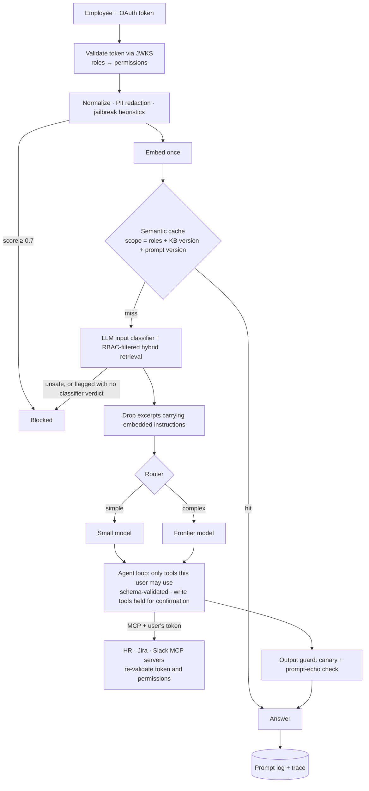

# Company Assistant

An internal AI assistant that answers policy questions from your own documents and gets
routine HR and IT work done (leave requests, IT tickets, Slack posts), for whichever
employee is signed in and only with what that employee is allowed to see and do.

| Capability | Where |
|---|---|
| Provider-agnostic API wrapper (Anthropic, OpenAI, Azure OpenAI) | [assistant/llm/](assistant/llm/) |
| System prompt from a persona file (name, tone, scope, escalation) | [config/persona.yaml](config/persona.yaml), [assistant/prompts.py](assistant/prompts.py) |
| RAG: heading-aware chunks, pgvector + full-text hybrid search | [assistant/rag/](assistant/rag/) |
| Actions through MCP servers: HR, Jira, Slack | [assistant/mcp_servers/](assistant/mcp_servers/), [assistant/tools/gateway.py](assistant/tools/gateway.py) |
| RBAC from the OAuth identity, enforced in the assistant *and* each MCP server | [config/rbac.yaml](config/rbac.yaml), [assistant/auth/](assistant/auth/) |
| Layered guardrails: input classifier, jailbreak/injection detection, PII redaction | [assistant/guardrails/](assistant/guardrails/) |
| Semantic cache, scoped by role and knowledge-base version | [assistant/cache/semantic.py](assistant/cache/semantic.py) |
| Model router: small model for simple turns, frontier model for hard ones | [assistant/router.py](assistant/router.py) |
| Observability: OpenTelemetry traces, including tool calls into MCP servers | [assistant/observability/](assistant/observability/) |
| Prompt log: redacted input/output, retrieval, tool calls, tokens, cost | [assistant/observability/prompt_log.py](assistant/observability/prompt_log.py) |
| Evaluation suite and release gate | [evals/](evals/), [.github/workflows/release-gate.yml](.github/workflows/release-gate.yml) |

## How a turn flows



Design decisions worth knowing:

- **Write actions need a human click.** Leave requests, tickets and Slack posts are never executed
  by the model. The tool call becomes a pending action (`POST /v1/actions/{id}/confirm`), keyed to
  the user, single-use, with a 15-minute expiry. If a prompt injection slips past every other layer,
  it still can't act on its own.
- **Identity flows end to end.** The employee's token (or an RFC 8693 exchanged token, with
  `MCP_TOKEN_MODE=exchange`) goes to each MCP server. Each server validates it and checks
  permissions again, so tools act *as that employee* and a bug in the assistant can't grant access.
- **Restricted documents never leave the database.** Role filtering happens inside the pgvector
  SQL query, not after retrieval.
- **Personal data doesn't reach the model provider or the database.** Emails, phone numbers,
  cards, IBANs, national IDs and secrets become placeholders such as `<EMAIL_1>`. The real values
  live in a per-conversation vault in Redis with a TTL, and are substituted back into tool
  arguments and into the answer the user sees.
- **History is append-only.** Within a turn, the provider's own assistant content (including Claude
  thinking blocks) is replayed verbatim; earlier turns are replayed as text. This keeps prompt
  caching effective and avoids preserved-thinking errors on current Claude models.

## Quickstart

```bash
cp .env.example .env          # add ANTHROPIC_API_KEY and OPENAI_API_KEY (embeddings)
make up                       # postgres+pgvector, redis 8, jaeger, keycloak, 3 MCP servers, API
make ingest                   # chunk, embed and index data/policies/

TOKEN=$(make -s kc-token USER=alice)    # dev realm users: alice mark hanna ivan ada (password = username)
curl -s localhost:8000/v1/chat -H "Authorization: Bearer $TOKEN" -H 'Content-Type: application/json' \
  -d '{"message": "Can I carry unused leave into next year?"}'
curl -s localhost:8000/v1/chat -H "Authorization: Bearer $TOKEN" -H 'Content-Type: application/json' \
  -d '{"message": "Book annual leave 21 to 23 December"}'      # returns pending_actions[].id
curl -s -X POST localhost:8000/v1/actions/<id>/confirm -H "Authorization: Bearer $TOKEN"
```

- API docs: http://localhost:8000/docs
- Traces: http://localhost:16686 (Jaeger). Search service `company-assistant`, or `mcp-hr` for the server side.
- Keycloak admin: http://localhost:8080 (admin/admin)
- Prompt log: `GET /v1/admin/prompt-logs` with `make -s kc-token USER=ada`

Without Keycloak, set `AUTH_MODE=dev` and mint tokens with `make -s token USER=mark ROLES=manager`.

Local development without Docker for the app itself:

```bash
make install && make test            # unit tests, no infrastructure needed
docker compose up -d postgres redis && make test-integration
make eval-offline
```

## Choosing models and providers

Models are `<provider>:<model>` strings, so switching is configuration only:

```bash
SMALL_MODEL=anthropic:claude-haiku-5-5        # default
FRONTIER_MODEL=anthropic:claude-opus-5-5      # default
SMALL_MODEL=azure:<deployment-name>           # Azure OpenAI: model = deployment
FRONTIER_MODEL=openai:<model-id>              # OpenAI or any OpenAI-compatible endpoint (OPENAI_BASE_URL)
```

Tiers may use different providers. If a call fails with a retryable error (rate limit, 5xx), the
turn fails over to the other tier. To add a provider, implement `LLMProvider.complete`
([assistant/llm/base.py](assistant/llm/base.py)) and register it in
[assistant/llm/registry.py](assistant/llm/registry.py).

Claude-specific behaviour in [anthropic_provider.py](assistant/llm/anthropic_provider.py):
adaptive thinking with `output_config.effort` (`SMALL_EFFORT` / `FRONTIER_EFFORT`), automatic prompt
caching, no sampling parameters (rejected since API version 2026-10-21), and **server-side refusal
fallbacks enabled** on Opus/Sonnet/Fable models (`fallbacks: "default"`). A request a safety
classifier declines is retried on a fallback model inside the same call. Set
`ANTHROPIC_FALLBACKS=false` to turn this off.

Anthropic has no embeddings endpoint, so embeddings default to OpenAI `text-embedding-3-small`
(`EMBEDDING_MODEL=azure:<deployment>` also works). Changing the embedding model or dimension means
dropping the `chunks` table and re-ingesting; startup refuses a dimension mismatch.

## Access control

Roles come from the token (`OIDC_ROLES_CLAIM`, Keycloak's `realm_access.roles` by default) and map
to permissions in [config/rbac.yaml](config/rbac.yaml), with inheritance (`manager` inherits
`employee`). Three things are governed:

1. **Documents:** `allowed_roles` in each policy's front matter, filtered in SQL.
2. **Tools:** deny by default. A tool is offered only if `rbac.yaml` lists it and the caller holds
   its permission; a call to a tool that wasn't offered is refused and recorded as `denied`.
3. **Admin endpoints:** for example `admin:prompt_logs:read` and `admin:router:override`.

## Guardrail layers

| Layer | Catches | On a hit |
|---|---|---|
| Unicode normalization, length cap | zero-width/homoglyph obfuscation, oversized input | normalize / truncate |
| PII and secret redaction | emails, phones, cards (Luhn), IBAN (mod-97), SSN, CPR, IPs, API keys | placeholder |
| Jailbreak/injection heuristics | known attack patterns (instruction override, persona, role spoofing, prompt extraction, exfiltration, encoding tricks) | ≥ 0.7 block; ≥ 0.4 classifier decides, or block if it's unavailable |
| LLM input classifier (small model) | paraphrased jailbreaks, pasted injections, data exfiltration, harmful requests | block |
| Untrusted-content screen | instructions hidden in retrieved policy text or tool output | drop the excerpt / flag the tool output |
| Confirmation gate | any side effect | wait for the user's click |
| Output guard | system-prompt leakage (canary token, 8-gram overlap) | replace the answer |

## Evaluation and release gate

```bash
python -m evals.run --offline --gate     # guardrail heuristics, PII, router, RBAC policy: free, every PR
python -m evals.run --online --gate      # full pipeline against the stack: costs tokens
python -m evals.run --online --gate --baseline evals/reports/<previous>.json
```

Online metrics: retrieval recall, answer keyword accuracy, LLM-judge correctness against
reference answers, **RBAC leaks (must be 0)**, tool selection, end-to-end attack block rate and
benign pass rate, routing accuracy, p95 latency, and cost per turn. Thresholds live in
[evals/thresholds.yaml](evals/thresholds.yaml); with `--baseline`, any drop of more than 3 points
also fails. CI runs the offline gate on every PR and the online gate on `main` and tags; the image
is only built if both pass.

The datasets in [evals/datasets/](evals/datasets/) are a starting point. Grow them from real
traffic in the prompt log, especially guardrail false positives and attacks that got through.

The online job in CI is opt-in, so forks and fresh clones stay green: add the `ANTHROPIC_API_KEY`
and `OPENAI_API_KEY` repository secrets, then set the repository variable `RUN_ONLINE_EVALS=true`.
Until then, tagged releases are skipped rather than shipped without the full gate.

## Credentials in this repository

Every credential committed here is a **local development placeholder**: the Keycloak realm users
(password = username), the `dev-assistant-api-secret` client secret, the `admin/admin` Keycloak
console, the Postgres `assistant/assistant` login, and the default `DEV_JWT_SECRET` and `CANARY_SEED`.
None of them protects anything outside your machine. The app refuses to start with
`ENVIRONMENT=production` while `AUTH_MODE=dev` or the default `CANARY_SEED` is in use.

## What's a demo vs. production-ready

- **Backends:** `DemoHRBackend` is in-memory. Implement `HRBackend` for your HRIS (Workday,
  Personio, BambooHR...). Jira Cloud (`JIRA_BACKEND=cloud`) and the Slack Web API
  (`SLACK_BACKEND=web`) are real integrations.
- **Keycloak realm:** a dev realm with fixed passwords and direct-grant login. Point `OIDC_*` at your
  real IdP (Entra ID, Okta...) and switch to `MCP_TOKEN_MODE=exchange` for audience-scoped tokens.
- **Before production:** set real secrets (`CANARY_SEED`, DB and Redis credentials), enable TLS,
  turn on Redis persistence and encryption for the PII vault, add a retention policy for prompt logs,
  run more than one API replica behind a load balancer, and stream responses (SSE) for long answers.
